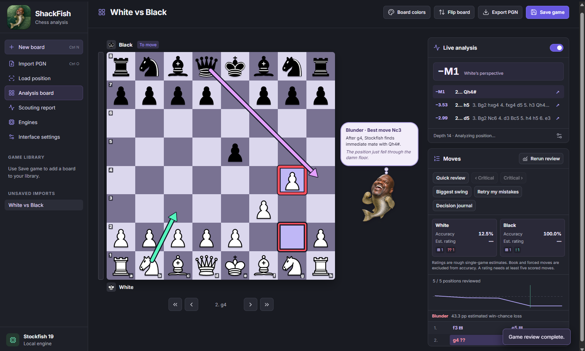
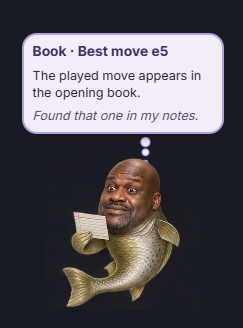
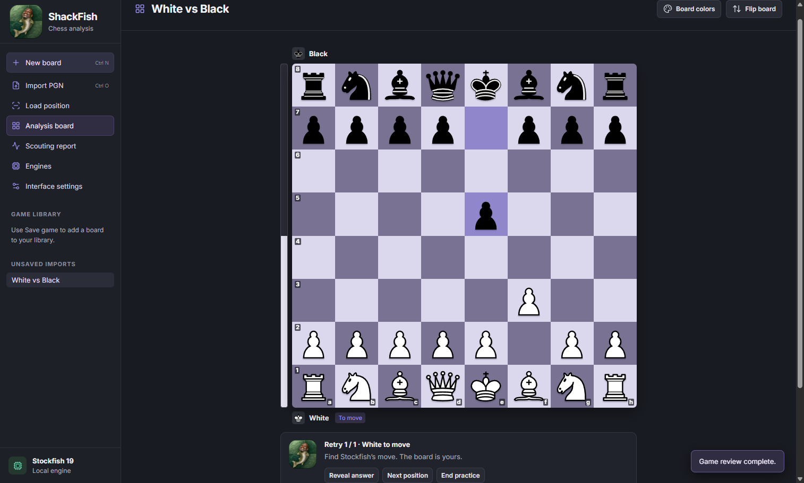
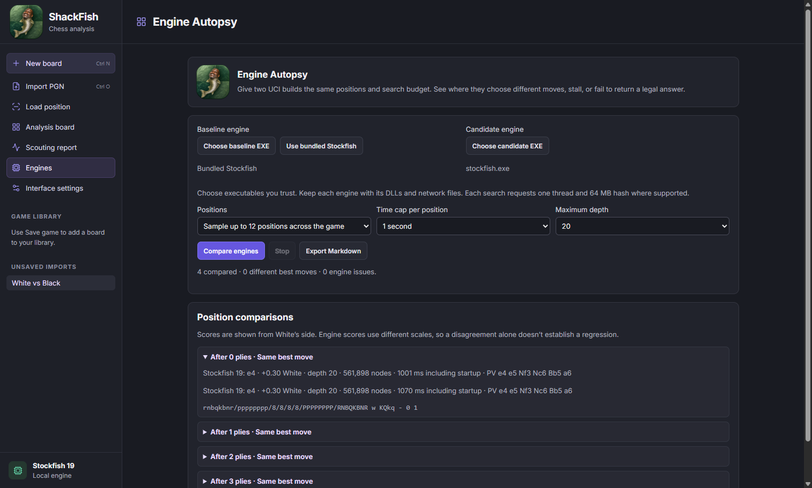

# ShackFish

ShackFish is a Windows desktop app for reviewing chess games, practicing mistakes, and comparing UCI engines. It uses the official Stockfish engine for local analysis and adds a board-side mascot that explains the moves worth revisiting.



*Game review catches the blunder in Fool's Mate. The green arrow shows Stockfish's recommendation from before the blunder, and the purple arrow shows Black's mating reply.*

## What you can do

| Feature | How it works |
| --- | --- |
| **Analysis board** | Play or drag legal moves on a standalone board. Follow Stockfish's suggested continuations, load a FEN, or flip the board. |
| **PGN review** | Open a PGN file or paste one or more games. Review the main line with an evaluation graph, move classifications, accuracy, and heuristic performance ratings. Use Quick Review for a first pass, then jump between critical moves or to the biggest swing. |
| **Variations and library** | Try an alternative without overwriting the original moves. Temporary variations disappear when you back out. Use **Save game** to keep a game, its review, and any variations you want to retain. Export PGN to share the moves and variations. |
| **Retry my mistakes** | Pick a side and replay critical positions with engine answers hidden. Attempt the move yourself or reveal Stockfish's choice. |
| **Decision Journal** | Record what you considered at a position. Apply the note, then click **Save game** to keep it with the game in the local library. |
| **Personal Scouting Report** | Sync up to 600 finished public games by Chess.com or Lichess username. Browse the history and run local analysis on a sample of up to 50 recent games. Click an example to investigate it on the board. |
| **Engine Autopsy** | Compare two local UCI executables on the same position or a sample from an imported game. Inspect best moves, evaluations, principal variations, and engine errors. Export a Markdown report with the search settings and reproduction commands. |
| **ShackFish coach and appearance** | Board highlights, engine arrows, and mascot reactions explain important moves. Adjust profanity, turn off commentary, customize board colors, and size text and buttons independently. |

Stockfish analysis and saved games stay on your machine. Scouting uses the sites' public game feeds and needs an internet connection. It asks for a username, without a password or access token.

## Screenshots

| Opening commentary | Retry my mistakes |
| --- | --- |
|  |  |
| ShackFish identifies a book move and shows the engine's preferred move. | Replay a mistake from the original position before revealing Stockfish's answer. |



*Engine Autopsy compares the bundled Stockfish against a second copy as a baseline check. Expand a position to inspect both lines and the FEN, or export the results as Markdown.*

## Run from source

Use 64-bit Windows and Node.js 24. In PowerShell, from the repository root:

```powershell
npm ci
```

Download the official Stockfish 19 Windows x86-64 universal archive specified in [engine/SOURCE.txt](engine/SOURCE.txt). Verify its SHA-256, extract the archive, and copy the engine executable to `engine/stockfish.exe`. If Electron's executable is missing after dependency installation, run `npx install-electron`.

```powershell
npm test       # Run the chess and engine tests
npm start      # Build the interface and launch the desktop app
npm run dist   # Build the Windows setup executable in release/
```

The source checkout does not include the prebuilt installer or the Stockfish binary. To compare another engine, extract its Windows release, keep its accompanying files alongside it, and choose the executable under **Engines → Choose candidate EXE**.

## Project layout

- [desktop/](desktop/) hosts Electron, the UCI adapter, file dialogs, and requests to the two public game feeds.
- [src/](src/) contains the chessboard, PGN tree, review scoring, scouting, Engine Autopsy, and mascot artwork and commentary.
- [test/](test/) covers PGN variations, chess rules, review scoring, and UCI communication.
- [scripts/](scripts/) contains the builder for the bundled opening lookup.

See [Engine and artwork notes](PROJECT-NOTES.md) for the review heuristics, engine provenance, and third-party credits.
